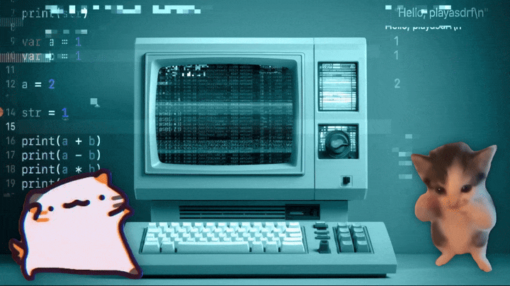

 
<!-- ═══════════════════════════════════════════════════════════════════ -->
<!--                        ⚡ NEON HACKER HEADER ⚡                      -->
<!-- ═══════════════════════════════════════════════════════════════════ -->

<div align="center">



<br>

```text
███████╗██╗  ██╗██╗███╗   ██╗ ██████╗ ██████╗ ██╗
██╔════╝██║  ██║██║████╗  ██║██╔═══██╗██╔══██╗██║
███████╗███████║██║██╔██╗ ██║██║   ██║██████╔╝██║
╚════██║██╔══██║██║██║╚██╗██║██║   ██║██╔══██╗██║
███████║██║  ██║██║██║ ╚████║╚██████╔╝██████╔╝██║
╚══════╝╚═╝  ╚═╝╚═╝╚═╝  ╚═══╝ ╚═════╝ ╚═════╝ ╚═╝
```


</div>

---

## 🧠 `~/about_me.sh`

```bash
#!/bin/bash
# ───────────────────────────────────────────────────────────────
#  Loading profile: shinobi.exe
# ───────────────────────────────────────────────────────────────

NAME="Shinobi"
ROLE="Cyber Security Student"
MISSION="Learn how to hack things (ethically 😉)"
OS="Arch Linux | Ubuntu | Kali Linux"
MINDSET="PASSIONATE • CURIOUS • RELENTLESS"

echo "[+] Initializing hacker mode..."
echo "[+] Target acquired: self-improvement"
echo "[+] Exploit ready: curiosity + caffeine"
echo "[✓] Access Granted."
```

## 🐍 `~/hacker.py`

```python
class Hacker:
    def __init__(self):
        self.name = "Shinobi"
        self.role = "Cyber Security Student"

        self.languages = [
            "Python", "C", "C++", "Java",
            "Rust", "JavaScript", "HTML", "CSS"
        ]

        self.tools = [
            "Docker", "LXD", "LXC", "Linux", "Bash"
        ]

        self.distros = ["Arch", "Ubuntu", "Kali"]
        self.vibe = "I break things to understand them better."
        self.state = "PASSIONATE"

    def learn(self):
        while True:
            self.exploit_knowledge()
            self.break_things()
            self.rebuild_stronger()
```

---

## ⚔️ `~/arsenal` — Tech & Skills

<div align="center">

### 🐍 Languages


### 🐳 Containers & Virtualization


### 🐧 Operating Systems


### 🛡️ Security & Tools


</div>

---

## 📊 `~/stats` — GitHub Analytics

<div align="center">


<br><br>


<br><br>


</div>

---

## 🕵️ `~/activity` — Contribution Graph

<div align="center">


</div>

---

## 🌐 `~/connect` — Find Me In The Wild

<div align="center">

<a href="YOUR_MEDIUM_PROFILE_URL">

</a>

<a href="YOUR_LINKEDIN_PROFILE_URL">

</a>

<a href="YOUR_HTB_PROFILE_URL">

</a>

<a href="https://github.com/IamjustaShinobi">

</a>

</div>

---

## 🎯 `~/roadmap` — Currently Leveling Up

```yaml
learning:
  - Binary Exploitation (pwn)
  - Web Application Penetration Testing
  - Reverse Engineering
  - Rust for Offensive Tooling
  - Malware Analysis Basics

building:
  - Custom Recon Scripts in Python
  - Dockerized CTF Environments
  - Technical Write-ups on Medium

grinding:
  - Hack The Box Machines 🎯
  - TryHackMe Rooms
  - PortSwigger Web Security Academy
```

---

## 💀 `~/quote.txt`

<div align="center">

> "The quieter you become, the more you are able to hear."
>
> — Kali

> "Hackers are not criminals. Hackers are artists, and computers are their canvas."

### PASSIONATE. PERSISTENT. UNSTOPPABLE. ⚡

</div>

---

<div align="center">

```text
╔══════════════════════════════════════════════════════════════╗
║   [ SYSTEM ACCESS LOG ]                                      ║
║   user    : shinobi                                           ║
║   access  : GRANTED                                           ║
║   message : Thanks for visiting. Now go break something. 😈   ║
╚══════════════════════════════════════════════════════════════╝
```


<br><br>


⭐ **Star some repos, fork some chaos** ⭐

</div>
